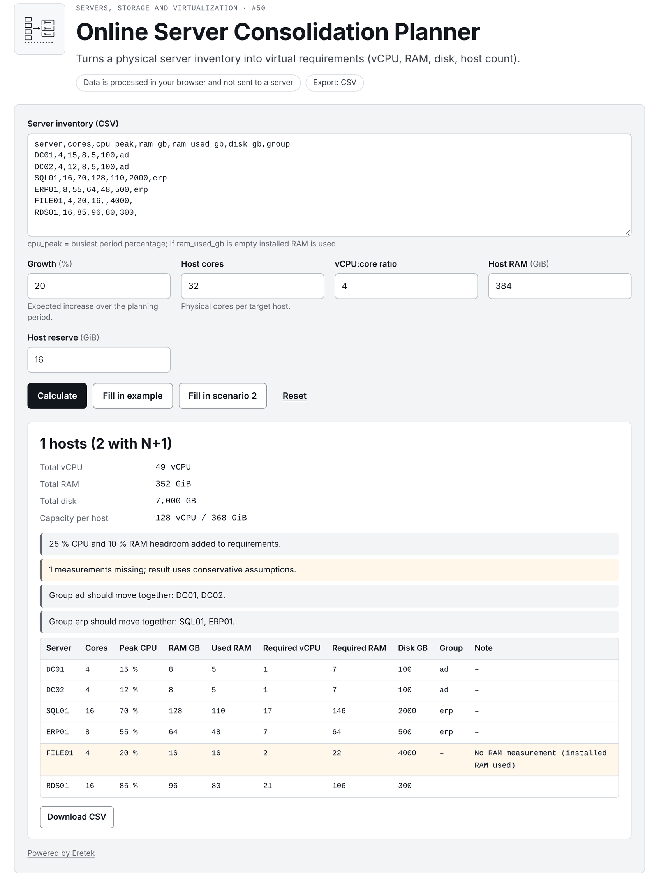

# Server Consolidation Planner

From a physical server inventory (CSV) with cores, peak CPU and used RAM, calculate the vCPU, RAM and host count needed for virtualization; flags missing measurements.

## Try it live

- [Türkçe](https://sistem.eretek.com/araclar/sunucu-konsolidasyon-planlayici)
- [English](https://sistem.eretek.com/en/tools/server-consolidation-planner)
- [Deutsch](https://sistem.eretek.com/de/werkzeuge/serverkonsolidierung-planer)



## What it does

Turns a physical server inventory into virtual requirements (vCPU, RAM, disk, host count).

When virtualizing physical servers, adding up nameplate values (cores, installed RAM) overstates host needs two- to threefold, while average usage alone causes bottlenecks at peak times. The tool derives requirements from peak CPU and used RAM, adds 25 % CPU and 10 % RAM headroom, sizes servers without measurements with conservative assumptions (CPU 100 %, RAM = installed) and flags them clearly.

## Where it helps

Collect at least two weeks of performance data for servers without measurements (perfmon, sar or your monitoring system). Validate the result with the VM vCPU/RAM and N+1 tools.

## How to use it

1. CSV header: `server, cores, cpu_peak, ram_gb, ram_used_gb, disk_gb, group` (server, cores and ram_gb required).
2. Enter growth and the target host's cores, RAM, reserve and vCPU ratio.
3. Press Calculate; download the table as CSV.

### Fields

| Field | Description |
|---|---|
| Server inventory (CSV) | cpu_peak = busiest period percentage; if ram_used_gb is empty installed RAM is used. |
| Growth | Expected increase over the planning period. |
| Host cores | Physical cores per target host. |
| vCPU:core ratio |  |
| Host RAM |  |
| Host reserve |  |

## Example input

Press **Fill in example** in the tool to load this input.

| Input | Value |
|---|---|
| Growth | `20` |
| Host cores | `32` |
| vCPU:core ratio | `4` |
| Host RAM | `384` |
| Host reserve | `16` |

**Server inventory (CSV)**

```text
server,cores,cpu_peak,ram_gb,ram_used_gb,disk_gb,group
DC01,4,15,8,5,100,ad
DC02,4,12,8,5,100,ad
SQL01,16,70,128,110,2000,erp
ERP01,8,55,64,48,500,erp
FILE01,4,20,16,,4000,
RDS01,16,85,96,80,300,
```

**Expected result:** 6 servers fit on one host (2 with N+1): 49 vCPU and 352 GiB RAM against 128 vCPU / 368 GiB per host; FILE01 has no RAM measurement, so installed 16 GB was used.

## Method and assumptions

Required vCPU = ceil(cores × peak % × (1 + growth) × 1.25), at least 1. Required RAM = ceil(used RAM × (1 + growth) × 1.10).

Hosts = max(ceil(total vCPU / (host cores × ratio)), ceil(total RAM / (host RAM − reserve))). One host is added for N+1.

## Limits and common mistakes

- Disk IOPS, network traffic and licensing constraints are not considered; disk is shown as a total only. Performance differences between CPU generations are not normalized.

## Run it locally

The tool is plain HTML, CSS and JavaScript with no build step and no dependencies.

```bash
git clone https://github.com/eretek/server-consolidation-planner.git
cd server-consolidation-planner
node scripts/serve.js        # or: python3 -m http.server 8080
```

Open <http://127.0.0.1:8080/>. Add `?lang=tr` or `?lang=de` for Turkish or German; without it the page follows the browser language and falls back to English. You can also open `index.html` directly from disk.

Run the tests (Node.js 18 or later):

```bash
node test/run.js    # or: npm test
```

The tests run the tool's own fixtures and the worked examples in all three languages without a browser.

## How it works

All processing happens in your browser. The tool makes no network requests, uses no cookies or browser storage, and does not upload files you select.

No server-side component is needed. The version on the Eretek website renders the same page through a private WordPress plugin; that plugin only produces the page markup and is not part of this repository.

| Path | Purpose |
|---|---|
| `index.html` | Page shell |
| `src/app.js` | Builds the page in Turkish, English or German from `src/data.js` |
| `src/data.js` | Field definitions, examples and all texts in three languages |
| `src/core.js` | Shared runtime: validation, number formats, result rendering, CSV/ICS export |
| `src/tool.js` | The calculation or analysis for this tool |
| `docs/screenshot.png` | Screenshot used in this README |
| `src/tools.css`, `src/page.css` | Styles |
| `test/run.js`, `test/cases.json` | Headless tests |

## License and attribution

This tool is released under the [Eretek Website Attribution License](LICENSE). You may use, modify and redistribute it, including commercially. If you make it available on a website or web application, show a visible, clickable credit linking to https://eretek.com/ on every page where the tool is available, for example:

```html
<a href="https://eretek.com/">Powered by Eretek</a>
```

You may add `rel="nofollow"` to the link. Keep the copyright notice and license text in copies and redistributions.
